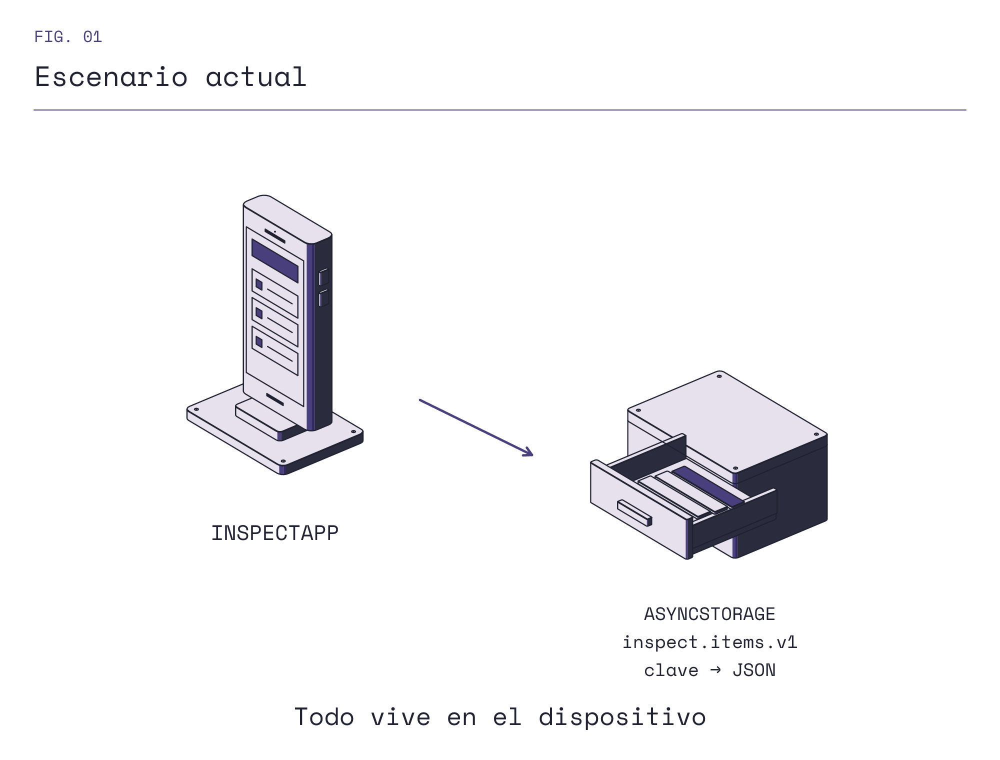
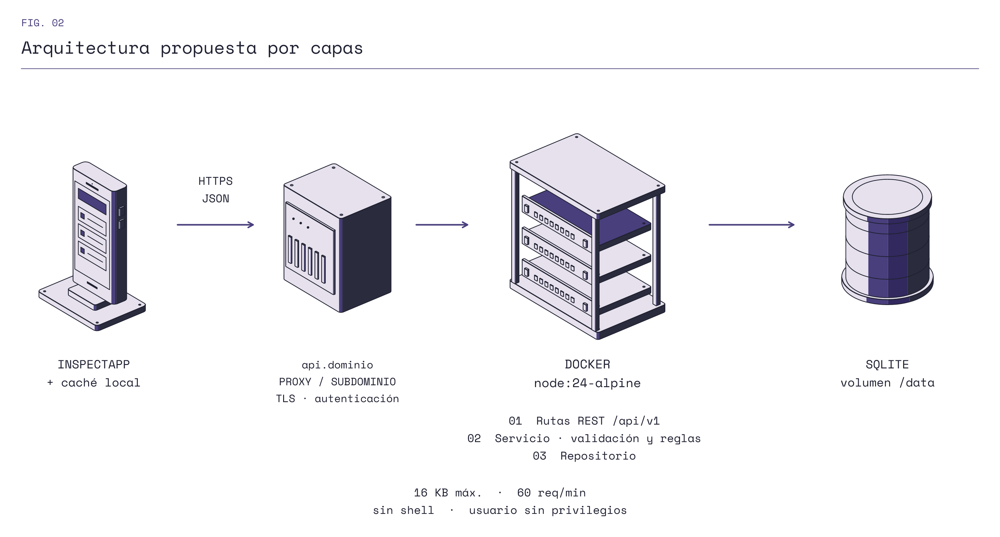
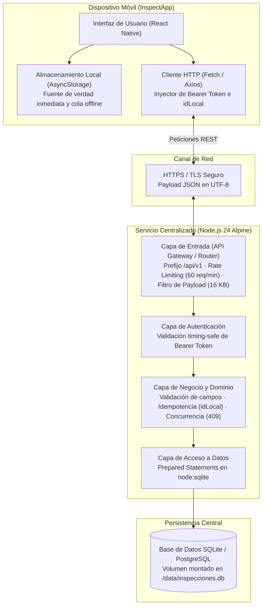

# 02 · De Almacenamiento Local a Servicio Remoto: Arquitectura por Capas

## 1. Escenario Actual (Unidad 2 · Monolito Local Aislado)

En la Unidad 2, **InspectApp** fue concebida e implementada como una aplicación móvil con persistencia puramente local sobre Expo y React Native. Toda la información levantada por el usuario reside exclusivamente en el almacenamiento aislado del dispositivo (*sandbox* de la aplicación).

### Características del modelo actual:
- **Almacenamiento en AsyncStorage:** La colección completa de registros se serializa como una cadena JSON bajo la clave `inspect.items.v1`.
- **Estrategia de persistencia segura:** En `src/store.js`, la función `commit()` sigue la regla de escribir primero en disco con `AsyncStorage.setItem()` y únicamente tras el éxito de la operación actualizar el estado en memoria (`useState`). Esto garantiza que la interfaz nunca muestre una inspección que no haya quedado guardada.
- **Papel de NetInfo:** La librería `@react-native-community/netinfo` se utiliza únicamente de manera pasiva. La función `useOnline()` actualiza un indicador visual en pantalla (`NetPill`) para informar al usuario si tiene red, pero no ejecuta peticiones remotas ni sincroniza datos.

### Limitaciones críticas del escenario local:
1. **Aislamiento de la información:** Las inspecciones quedan atrapadas en el teléfono del inspector; el personal de mantenimiento, los administradores de laboratorios y otros inspectores no tienen visibilidad de las fallas reportadas.
2. **Riesgo de pérdida de datos:** Si el dispositivo sufre una avería de hardware, desinstalación de la app o borrado de caché, toda la evidencia física acumulada se pierde irremediablemente.
3. **Falta de interoperabilidad:** No existe forma de alimentar sistemas de órdenes de trabajo, dashboards institucionales ni generar reportes globales consolidados.

---

## 2. Escenario Propuesto (Unidad 3 · Arquitectura Distribuida Cliente-Servidor)

Para superar las limitaciones del modelo aislado, se propone una **arquitectura distribuida cliente-servidor** desacoplada mediante un servicio centralizado con interfaz REST.

### Diagrama de Flujo Arquitectónico

---

## 3. Matriz de Responsabilidades por Capa

| Componente | Capa | Responsabilidades técnicas |
|---|---|---|
| **Aplicación Móvil** | Presentación y Cliente | - Renderizado fluido de interfaz (React Native). - Validación preliminar e inmediata de entradas de formulario. - Gestión del almacenamiento local en AsyncStorage (fuente de verdad inmediata para el usuario). - Gestión de la cola de sincronización offline y detección de cambios de red con NetInfo. - Generación de `idLocal` y consumo de endpoints REST mediante peticiones HTTP asíncronas. |
| **API REST** | Interfaz Pública / Contrato | - Definición estricta de rutas, verbos HTTP canónicos y esquemas de carga JSON. - Gestión de versionamiento en la URL (`/api/v1`). - Retorno de códigos de estado HTTP semánticos (200, 201, 204, 400, 401, 404, 409, 413, 415, 429). - Establecimiento de cabeceras de seguridad globales (`X-Content-Type-Options`, `Cache-Control`). |
| **Backend** | Lógica de Negocio y Reglas | - Autenticación centralizada mediante tokens criptográficamente seguros. - Validación exhaustiva de negocio (rangos de longitud, valores permitidos en catálogos). - Control de flujo: limitación de tasa (*rate limiting*) y control estricto de tamaño de carga útil (16 KB). - Manejo de idempotencia para neutralizar peticiones duplicadas provenientes de reintentos móviles. - Detección de concurrencia optimista y gestión de versiones mediante la marca temporal `actualizada`. |
| **Base de Datos** | Persistencia Central | - Almacenamiento transaccional ACID de las inspecciones de todos los inspectores. - Mantenimiento de restricciones de unicidad (`id_local UNIQUE`) e integridad referencial. - Indexación para consultas eficientes con filtros por `estado`, `espacio` y paginación. |

---

## 4. Justificación Técnica: ¿Por qué Arquitectura en Capas y NO Microservicios?

Una de las decisiones arquitectónicas fundamentales tomadas por el equipo de ingeniería fue optar por un **sistema monolítico modular organizado por capas** y descartar categóricamente una arquitectura basada en microservicios. Las razones técnicas son:

1. **Un solo recurso y dominio cohesivo:** El sistema gira en torno a un único recurso de negocio (`Inspección`). Dividir una funcionalidad tan acotada en múltiples microservicios (por ejemplo: un servicio para crear, otro para listar y otro para notificar) introduciría una fragmentación innecesaria.
2. **Eliminación de la sobrecarga de red (Latencia):** En microservicios, cada operación requiere múltiples llamadas remotas RPC/HTTP entre servicios (*east-west traffic*), sumando latencia y multiplicando los puntos de fallo. En una arquitectura por capas, las llamadas entre la lógica y el acceso a datos son funciones en memoria a velocidad de microsegundos.
3. **Consistencia transaccional sin complejidad distribuida:** Un servicio único permite transacciones ACID locales y directas sobre SQLite o PostgreSQL. Los microservicios obligarían a implementar patrones de consistencia eventual complejos (como el patrón Saga o Two-Phase Commit), totalmente sobredimensionados para esta etapa del proyecto.
4. **Simplicidad operativa y de despliegue:** Un solo servicio empaquetado en un contenedor Docker puede ser mantenido, versionado, auditado y respaldado por un único equipo de desarrollo sin requerir una malla de servicios (*service mesh*), clústeres Kubernetes ni orquestadores distribuidos complejos.

---

## 5. Estrategia de Despliegue con Docker

El servicio backend se empaqueta de acuerdo con los más altos estándares de la industria para contenedores de producción:

- **Imagen base ultra ligera (`node:24-alpine`):** Con un tamaño de tan solo 244 MB en disco (62.5 MB comprimida en el registro), reduce la superficie de ataque al no incluir herramientas innecesarias como compiladores C++, utilidades de depuración complejas ni paquetes del sistema prescindibles.
- **Principio de mínimo privilegio (`USER node`):** El proceso Node no se ejecuta como usuario `root`. Esto mitiga de forma contundente cualquier intento de escalada de privilegios en el host en caso de una vulnerabilidad en la aplicación.
- **Sistema de archivos de solo lectura (`read_only: true`):** El contenedor no permite escritura en su sistema de archivos base; los archivos temporales se aíslan en memoria volátil (`tmpfs: /tmp`).
- **Persistencia desacoplada en volumen nombrado:** La base de datos SQLite se almacena en el volumen Docker `datos:/data`, asegurando que la información sobreviva a reinicios, actualizaciones o reconstrucciones del contenedor.
- **Exposición detrás de subdominio seguro:** En un entorno de producción, el contenedor se publica detrás de un proxy inverso bajo un subdominio específico (e.g., `https://api.dominio`) configurado con certificados TLS modernos y políticas HSTS.
