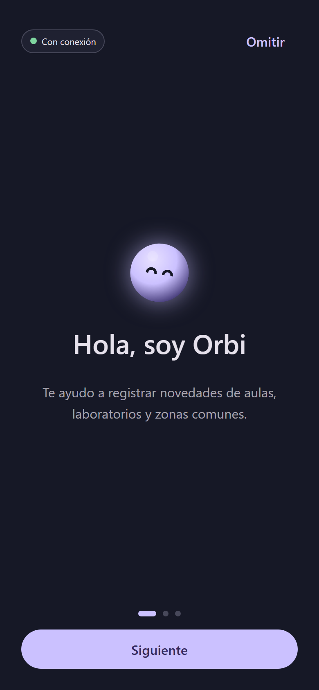
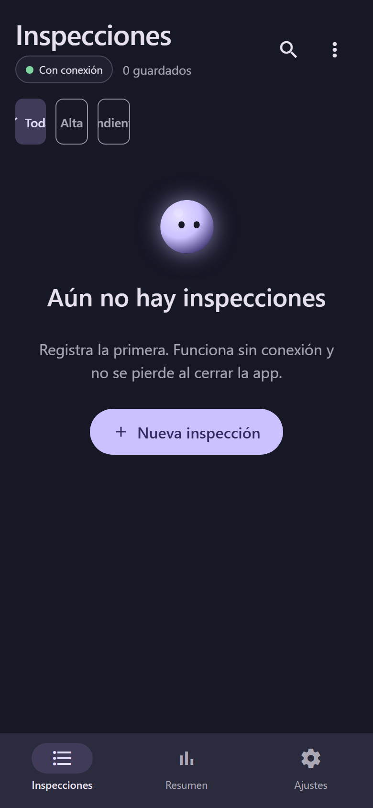
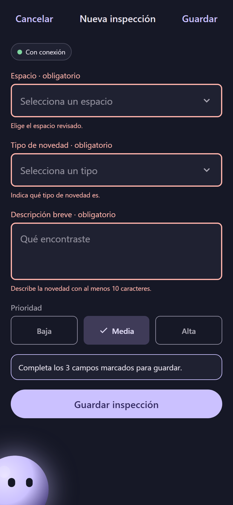
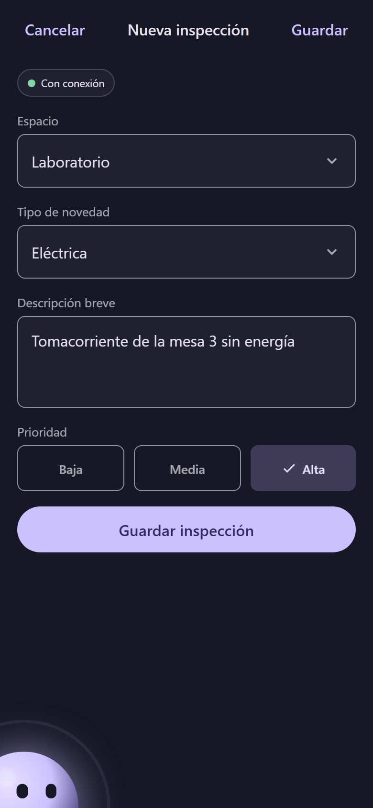
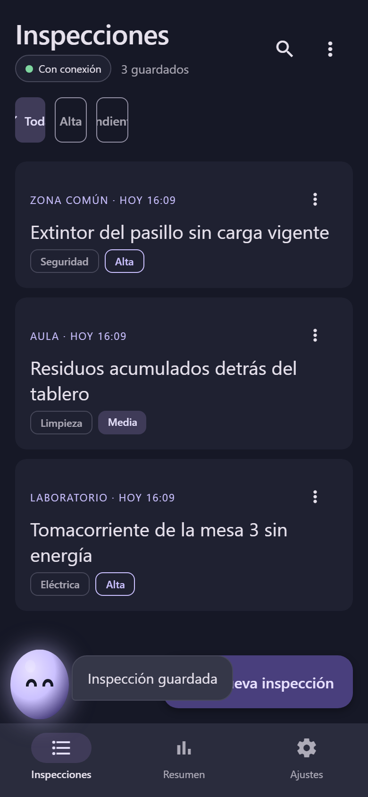
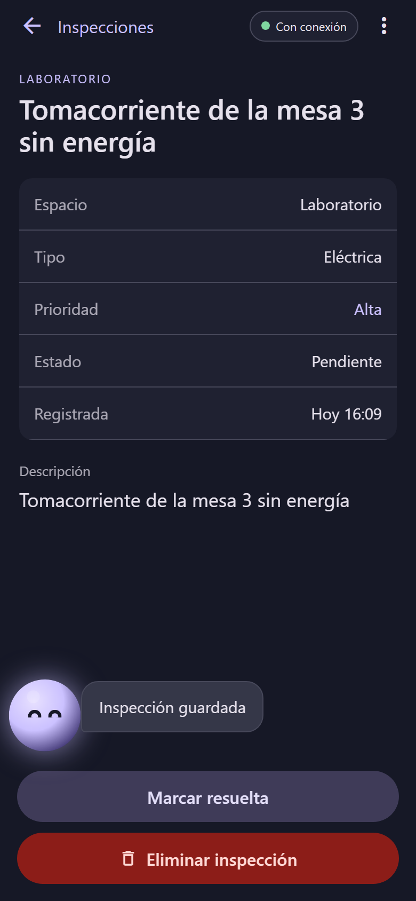
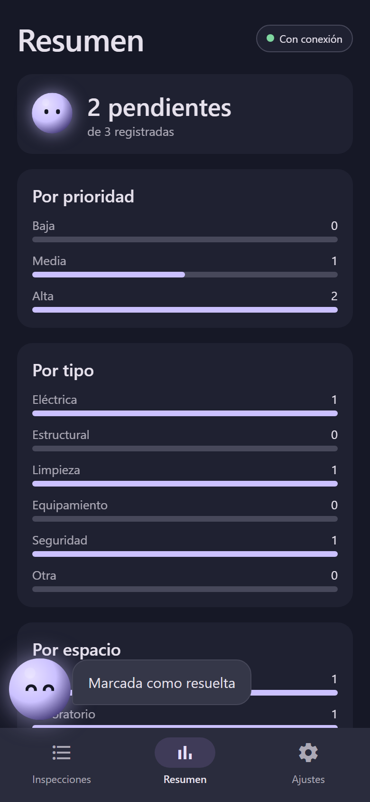
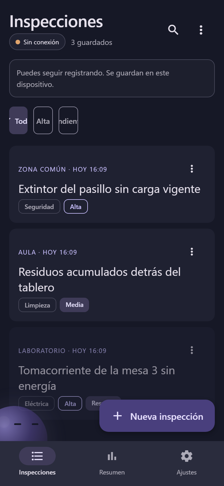
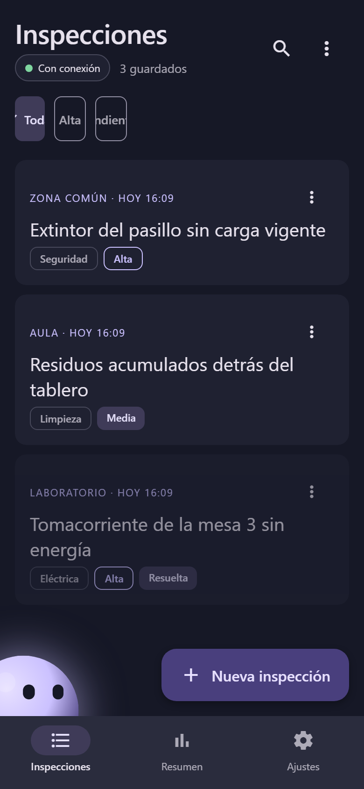

# 05 · Comprobación Práctica del Servicio REST y Suite de Pruebas

## 1. Puesta en Marcha del Servidor de Pruebas

Para garantizar la reproducibilidad y el aislamiento del entorno, el servidor backend de **InspectApp** fue desplegado como un contenedor Docker sobre `node:24-alpine`.

### 1.1. Generación del Token y Configuración de Entorno
El servidor protege sus rutas mutables mediante un token secreto configurado a través de variables de entorno:

```bash
# Entrar al subdirectorio del servidor
cd servidor

# Generar un token criptográfico de 32 caracteres hexadecimales (16 bytes)
node -e "console.log(require('crypto').randomBytes(16).toString('hex'))"
# Ejemplo de salida: (32 caracteres hexadecimales aleatorios)

# Crear el archivo .env a partir de la plantilla
node -e "console.log('API_TOKEN='+require('crypto').randomBytes(16).toString('hex'))" > .env   # token aleatorio

# Asignar el token generado dentro de .env
# API_TOKEN=<tu token>
```

### 1.2. Construcción y Arranque del Contenedor
```bash
docker compose up -d --build
```

El servicio expone el puerto `3000` en la interfaz de bucle invertido (`127.0.0.1:3000`) y cuenta con una directiva de salud (`HEALTHCHECK`) que consulta `GET /api/v1/salud` cada 10 segundos.

```bash
curl -i -sS http://127.0.0.1:3000/api/v1/salud
# HTTP/1.1 200 OK
# Content-Type: application/json
# {"ok":true}
```

---

## 2. Ejecución de la Suite de Pruebas (`pruebas.sh`)

La suite de pruebas automatizadas está definida en [`servidor/pruebas.sh`](../../servidor/pruebas.sh). El script ejecuta secuencialmente 13 pruebas HTTP contra los endpoints del servidor y una prueba de auditoría del contenedor Docker, volcando las cabeceras y cuerpos recibidos en la carpeta [`docs/unidad-3/evidencia/`](./evidencia/).

```bash
set -a; . ./.env; set +a; bash pruebas.sh
```

### Nota Crítica sobre Windows y la Codificación UTF-8
> [!IMPORTANT]
> **Manejo de tildes y caracteres especiales en terminales Windows:**  
> En entornos Windows (PowerShell, CMD, Git Bash), pasar argumentos JSON directamente en el parámetro `-d` de `curl` suele sufrir corrupción de caracteres debido a la página de códigos activa de la consola (como CP1252 o CP437). Textos como `"Eléctrica"`, `"energía"` o `"Zona común"` pueden transmitirse como caracteres deformados (*mojibake*: `Eléctrica`), provocando rechazos de validación en el servidor.  
> 
> Para garantizar la preservación estricta de la codificación UTF-8, el script `pruebas.sh` transmite los cuerpos JSON a través de la entrada estándar en modo binario:
> ```bash
> curl -i -sS -X POST "$BASE/inspecciones" \
>   -H "Content-Type: application/json" \
>   -H "Authorization: Bearer $API_TOKEN" \
>   --data-binary @- <<< '{"idLocal":"1763316000000","espacio":"Laboratorio","tipo":"Eléctrica","descripcion":"Tomacorriente de la mesa 3 sin energía","prioridad":"Alta"}'
> ```

---

## 3. Matriz de Resultados de las Pruebas HTTP

Se ejecutaron 13 pruebas contra los endpoints de la API y una prueba de verificación del contenedor Docker. Se obtuvo un **100% de éxito (14/14 pruebas superadas)**:

| # | Prueba realizada | Método y Endpoint | Código Esperado | Código Obtenido | Resultado | Archivo de Evidencia Cruda |
|---|---|---|:-:|:-:|:-:|---|
| **01** | Comprobación de salud | `GET /api/v1/salud` | **200** | **200** | ✔ Superada | [`01-salud.txt`](./evidencia/01-salud.txt) |
| **02** | Creación de inspección | `POST /api/v1/inspecciones` | **201** | **201** | ✔ Superada | [`02-crear.txt`](./evidencia/02-crear.txt) |
| **03** | Reenvío idempotente (`idLocal`) | `POST /api/v1/inspecciones` | **200** | **200** | ✔ Superada | [`03-crear-repetido.txt`](./evidencia/03-crear-repetido.txt) |
| **04** | Validación: descripción corta | `POST /api/v1/inspecciones` | **400** | **400** | ✔ Superada | [`04-crear-invalido.txt`](./evidencia/04-crear-invalido.txt) |
| **05** | Seguridad: escritura sin token | `POST /api/v1/inspecciones` | **401** | **401** | ✔ Superada | [`05-sin-token.txt`](./evidencia/05-sin-token.txt) |
| **06** | Listar colección paginada | `GET /api/v1/inspecciones?limit=5` | **200** | **200** | ✔ Superada | [`06-listar.txt`](./evidencia/06-listar.txt) |
| **07** | Consultar inspección por ID | `GET /api/v1/inspecciones/1` | **200** | **200** | ✔ Superada | [`07-consultar-uno.txt`](./evidencia/07-consultar-uno.txt) |
| **08** | Actualización parcial (`PATCH`) | `PATCH /api/v1/inspecciones/1` | **200** | **200** | ✔ Superada | [`08-actualizar.txt`](./evidencia/08-actualizar.txt) |
| **09** | Conflicto de versión optimista | `PATCH /api/v1/inspecciones/1` | **409** | **409** | ✔ Superada | [`09-conflicto.txt`](./evidencia/09-conflicto.txt) |
| **10** | Eliminación de recurso | `DELETE /api/v1/inspecciones/1` | **204** | **204** | ✔ Superada | [`10-eliminar.txt`](./evidencia/10-eliminar.txt) |
| **11** | Verificación de eliminación | `GET /api/v1/inspecciones/1` | **404** | **404** | ✔ Superada | [`11-eliminado.txt`](./evidencia/11-eliminado.txt) |
| **12** | Carga útil excesiva (20 KB) | `POST /api/v1/inspecciones` | **413** | **413** | ✔ Superada | [`12-cuerpo-grande.txt`](./evidencia/12-cuerpo-grande.txt) |
| **13** | Límite de tasa (*rate limit*) | `GET /api/v1/salud` (ráfaga) | **429** | **429** | ✔ Superada | [`13-limite.txt`](./evidencia/13-limite.txt) |
| **14** | Auditoría y métricas del contenedor | `docker inspect` + `docker stats` | — | — | ✔ Superada | [`14-imagen.txt`](./evidencia/14-imagen.txt) |

> [!NOTE]
> En la prueba 13, el límite de frecuencia (*rate limit*) de 60 peticiones/minuto se activó en la **petición 46 del bucle**, debido a que las pruebas 01 a 12 ejecutadas segundos antes ya habían consumido parte de la cuota asignada a la IP local dentro de la misma ventana temporal de un minuto.

---

## 4. Auditoría del Contenedor Docker (Evidencia 14)

De acuerdo con el registro en [`evidencia/14-imagen.txt`](./evidencia/14-imagen.txt):

- **Imagen generada:** `servidor-inspecciones-api:latest`.
- **Tamaño en disco:** **244 MB** (62.5 MB comprimida en transferencia).
- **Usuario de ejecución:** `node` (no-root).
- **Consumo de memoria en ejecución:** **14.79 MiB** de los **128 MiB** asignados como techo (`mem_limit: 128m`), equivalente a un uso del **11.55%**.
- **Consumo de CPU:** **0.01%** en estado pasivo sobre un tope de 0.5 núcleos asignados (`cpus: 0.5`).
- **Procesos concurrentes:** 7 hilos internos de la máquina virtual V8 / libuv.
- **Configuración de seguridad activa:** `read_only: true`, `cap_drop: ALL`, `no-new-privileges: true`.

---

## 5. Galería de Capturas de InspectApp

A continuación se documenta el comportamiento de la aplicación móvil (ejecutada en Expo web sobre un *viewport* de dimensiones móviles):

| Captura | Archivo | Descripción técnica |
|---|---|---|
|  | [`app-01-tutorial.png`](img/app-01-tutorial.png) | **Onboarding / Tutorial de bienvenida:** Presentación de la mascota interactiva Orbi explicando el propósito de la app y destacando que el sistema opera con persistencia local garantizada. |
|  | [`app-02-vacia.png`](img/app-02-vacia.png) | **Pantalla principal vacía:** La lista de inspecciones renderiza un estado informativo (*empty state*) invitando al inspector a registrar la primera novedad física. |
|  | [`app-03-validacion.png`](img/app-03-validacion.png) | **Validación activa de formulario:** Al intentar guardar sin cumplir las reglas, se marcan en rojo los selectores de espacio y tipo, y se exige una descripción de al menos 10 caracteres. |
|  | [`app-04-formulario.png`](img/app-04-formulario.png) | **Formulario diligenciado:** Selección de recinto (*Laboratorio*), tipo de novedad (*Eléctrica*), descripción detallada y prioridad (*Alta*). |
|  | [`app-05-lista.png`](img/app-05-lista.png) | **Visualización de colección:** FlatList con tarjetas de inspección, etiquetas clasificatorias por color, fecha relativa y selector de filtros por estado. |
|  | [`app-06-detalle.png`](img/app-06-detalle.png) | **Vista de detalle individual:** Visualización completa de los atributos del registro con controles para alternar entre Pendiente/Resuelta, editar y eliminar. |
|  | [`app-07-resumen.png`](img/app-07-resumen.png) | **Panel de métricas (Resumen):** Consolidación cuantitativa de inspecciones totales, porcentaje de resolución y desglose por espacio y severidad. |
|  | [`app-08-sin-conexion.png`](img/app-08-sin-conexion.png) | **Detección offline:** La píldora `NetPill` informa en tiempo real «Sin conexión» mediante NetInfo, permitiendo continuar registrando novedades sin bloqueo. |
|  | [`app-09-persistencia.png`](img/app-09-persistencia.png) | **Comprobación de persistencia:** Los registros sobreviven al cierre y recarga de la aplicación gracias al almacenamiento en `AsyncStorage`. |
