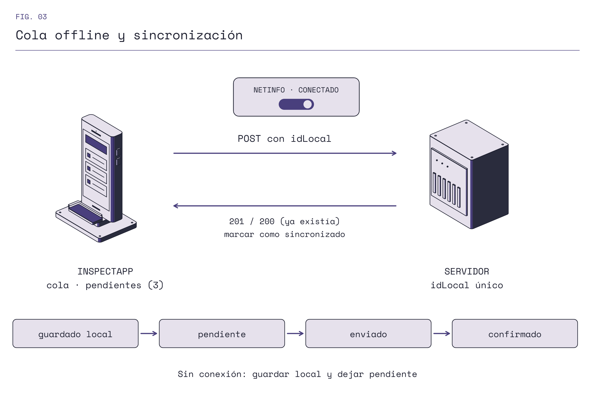
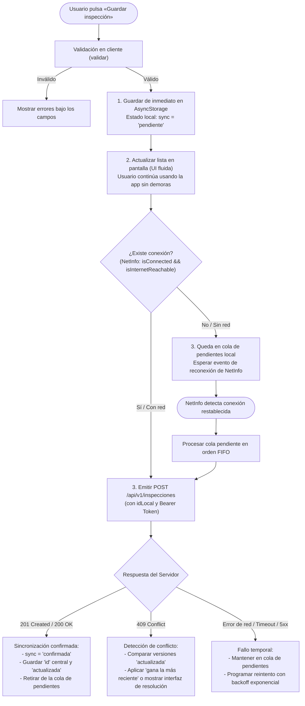

# 06 · Conectividad y Funcionamiento Offline

## 1. El Reto de la Conectividad en Aplicaciones Móviles de Campo

En el contexto operativo de **InspectApp**, los inspectores recorren frecuentemente recintos con baja o nula cobertura de señal (sótanos técnicos, cuartos de máquinas, laboratorios aislados o pasillos de infraestructura). 

Una aplicación móvil moderna no puede asumir una conexión de red permanente ni bloquear la interfaz del usuario mostrando ruedecillas de carga infinitas ante una caída de señal. InspectApp implementa el principio **«Offline First»** (primero lo local), garantizando que el usuario pueda registrar y consultar inspecciones en cualquier circunstancia.

---

## 2. Diagrama de Flujo del Protocolo de Sincronización

A continuación se ilustra el flujo de decisión técnica ante la creación o edición de una inspección, destacando el rol evaluador de `NetInfo` y la persistencia local previa:

---

## 3. Separación de Conceptos: Estado de Negocio vs. Estado de Sincronización

Un error frecuente en diseños preliminares consiste en mezclar la situación operativa de la novedad física con el estado de transmisión de red (por ejemplo, definir un estado de negocio denominado `Pendiente_Sincronizacion`).

Dicha mezcla produce inconsistencias graves: si un inspector marca como «Resuelta» una anomalía mientras está en un sótano sin señal, clasificar el registro como `Pendiente_Sincronizacion` haría creer al sistema que la novedad física sigue averiada cuando en realidad ya fue corregida en el recinto.

InspectApp desacopla tajantemente ambas dimensiones:

### A. Estado de Negocio (`estado`)
Representa la situación del recinto físico en la vida real:
- **`Pendiente`:** La anomalía física (p. ej. tomacorriente sin energía) sigue presente y requiere atención.
- **`Resuelta`:** El personal técnico solucionó la novedad.

### B. Estado de Sincronización (`sync`)
Metadato estrictamente técnico que gobierna el ciclo de vida del transporte HTTP:
- **`local`:** Novedad creada en el dispositivo, aún no procesada por el motor de red.
- **`pendiente`:** El registro está encolado en AsyncStorage esperando que haya enlace de datos disponible.
- **`enviando`:** Se encuentra en tránsito dentro de una petición HTTP activa.
- **`confirmada`:** El servidor respondió con código 200 o 201; el registro ya tiene un `id` central asignado y coincide con la base central.
- **`conflicto`:** El servidor rechazó con 409 y se requiere intervención o conciliación de versiones.

---

## 4. Política de Reintentos con Espera Creciente (*Exponential Backoff*)

Cuando el dispositivo tiene conectividad intermitente o el servidor central atraviesa una ventana de mantenimiento, la cola de sincronización **nunca debe reintentar en un bucle cerrado continuo**. Reintentar sin pausa agotaría la batería del teléfono, saturaría el plan de datos móviles y provocaría un ataque de denegación de servicio involuntario (*thundering herd*) contra el backend.

### Estrategia implementada:
1. **Reintentos guiados por eventos:** Se utiliza el *listener* de `NetInfo.addEventListener()`. Si el teléfono no tiene conexión, la cola permanece inactiva (dormida a costo cero de CPU/red). Tan pronto el sistema operativo notifica reconexión, se dispara la cola.
2. **Espera creciente con fluctuación aleatoria (*Jitter*):** Si la red parece disponible pero las peticiones fallan (por ejemplo, respuestas 503 o cortes a mitad de transmisión), el tiempo de espera entre reintentos se calcula como:
   $$T = \min(T_{\text{base}} \times 2^{\text{intento}} + \text{jitter}, T_{\text{máximo}})$$
   - $T_{\text{base}} = 1\text{ segundo}$
   - Secuencia de espera: 1s, 2s, 4s, 8s, 16s, hasta un tope máximo de 60 segundos.
   - El *jitter* (valor aleatorio de ±500 ms) desincroniza las peticiones de múltiples dispositivos que intentan reconectarse simultáneamente.

---

## 5. Garantía de Idempotencia mediante `idLocal`

En redes inalámbricas, es habitual que la petición `POST` alcance al servidor y este guarde la inspección en la base de datos, pero la respuesta HTTP `201 Created` se pierda debido a un corte súbito de cobertura.

Al recuperar la señal, el teléfono reenvía la inspección. Gracias al campo `idLocal` (generado originalmente en el cliente con `Date.now()`):
- El servidor ejecuta `SELECT * FROM inspecciones WHERE id_local = ?`.
- Detecta que la inspección ya fue persistida previamente.
- Retorna el registro original con código **`200 OK`** en lugar de duplicarlo.
- El cliente móvil recibe su respuesta exitosa, actualiza su estado local a `sync: "confirmada"` y remueve la inspección de la cola de pendientes sin efectos secundarios.

---

## 6. Resolución de Conflictos Concurrentes (HTTP 409 Conflict)

Cuando múltiples inspectores operan sobre los mismos recintos sin conexión simultánea, pueden suscitarse ediciones concurrentes:

1. El inspector **A** descarga la inspección 1 (`actualizada: 14:00:00`).
2. El inspector **B** descarga la misma inspección 1 (`actualizada: 14:00:00`).
3. El inspector **B** se conecta y cambia el estado a `Resuelta` (`actualizada: 14:05:00`). El servidor aplica el cambio.
4. El inspector **A** intenta posteriormente enviar una modificación offline con su versión antigua (`actualizada: 14:00:00`).
5. El servidor detecta que `clientDate < serverDate` y **rechaza con HTTP 409 Conflict**, adjuntando la versión vigente en el servidor.

### Estrategias de conciliación en el cliente:
- **Para atributos discretos (como `estado`):** Se aplica la regla «gana la marca temporal más reciente» (*Last-Write-Wins*), siempre que la intención del usuario final no se contradiga.
- **Para descripciones divergentes:** La aplicación móvil presenta una tarjeta visual de conflicto mostrando la versión remota y la versión local, permitiendo al inspector fusionar ambas observaciones o confirmar cuál prevalece.

---

## 7. Qué Datos Deben Residir en el Almacenamiento Local

Para garantizar un funcionamiento offline ininterrumpido sin comprometer la seguridad ni saturar la memoria del dispositivo, se establece la siguiente clasificación:

| Categoría de dato | ¿Debe persistir en local? | Mecanismo y Justificación técnica |
|---|:---:|---|
| **Cola de sincronización pendiente** | **SÍ** | Esencial. Almacena en `AsyncStorage` los registros con `sync: "pendiente"` para que no se pierdan si la app se cierra o el teléfono se apaga. |
| **Caché de inspecciones recientes** | **SÍ** | Permite al inspector consultar en pantalla las últimas inspecciones descargadas mientras recorre zonas sin red. |
| **Preferencias de usuario y UI** | **SÍ** | Guarda en `inspect.prefs.v1` configuraciones como el tamaño de tipografía (`escala`) o el estado de tutorial completado (`visto`). |
| **Archivos multimedia temporales** | **SÍ** *(Futuro)* | En futuras etapas con fotografías, las imágenes capturadas deben residir en el sistema de archivos local (`FileSystem.cacheDirectory`) hasta confirmarse la subida al Object Storage. |
| **Tokens de autenticación en texto plano** | **NO** | **Prohibido.** Guardar tokens de acceso o contraseñas en texto claro dentro de `AsyncStorage` es una vulnerabilidad grave (accesible mediante volcados de depuración o respaldos no cifrados). Deben resguardarse mediante almacenamiento seguro protegido por hardware (`expo-secure-store`, Android Keystore o iOS Keychain). |
